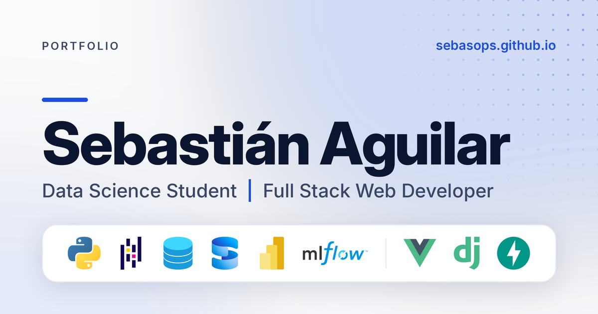

<!-- README.md -->
<!--
  Documentación del repositorio del portafolio: qué es, cómo ejecutarlo,
  cómo está organizado y cómo se publica.
-->

# Portafolio de Sebastián Aguilar

**Sitio:** <https://sebasops.github.io>

> *Personal portfolio of Sebastián Aguilar, a Data Science student and full stack web developer. Bilingual (Spanish/English), static, built with Astro and hosted on GitHub Pages.*

Portafolio personal orientado a ciencia de datos, con el desarrollo web como segundo foco. Es un sitio estático y bilingüe (español e inglés) construido con Astro.



## Qué incluye

- **Inicio**, **Proyectos** (listado y página de detalle de cada uno) y **Sobre mí** (trayectoria, formación, certificaciones y contacto), más una página 404.
- **Bilingüe** con rutas `/es/` y `/en/`, selector de idioma que conserva la página, y una raíz (`/`) que elige el idioma según el navegador.
- **Galería de capturas** accesible (teclado, miniaturas, contador), video del flujo y línea de tiempo con detalles desplegables.
- **SEO:** metadatos por página, URL canónica, `hreflang`, Open Graph, `sitemap` y `robots.txt`.
- **Accesibilidad:** HTML semántico, foco visible, navegación por teclado y respeto de la preferencia de movimiento reducido.
- **JavaScript mínimo:** solo la galería y la redirección de idioma de la raíz; el resto es HTML y CSS estáticos.

## Stack

- [Astro](https://astro.build) y TypeScript
- CSS con alcance por componente y tokens de diseño como variables CSS
- Tipografía con la API de fuentes de Astro (Fontsource), servida desde el propio sitio
- `@astrojs/sitemap`
- GitHub Actions y GitHub Pages

## Estructura

```text
src/
├── assets/projects/   # capturas de los proyectos (Astro las optimiza)
├── components/        # piezas reutilizables (navegación, hero, galería, línea de tiempo...)
├── data/              # contenido: site, skills, tools, projects, experience, credentials
├── i18n/              # ui.ts (textos de interfaz) y utils.ts (utilidades de idioma)
├── layouts/           # BaseLayout.astro
├── pages/             # rutas: index.astro (raíz), es/, en/ y 404.astro
└── styles/            # global.css (tokens de diseño)
public/                # archivos estáticos: cv/, icons/, videos/, favicon.svg, robots.txt
.github/workflows/     # deploy.yml (publicación en GitHub Pages)
```

## Ejecutar en local

Requisitos: Node.js 22.23.4 o superior (lo exige la versión de Astro del proyecto) y npm.

```bash
git clone https://github.com/SebasOps/SebasOps.github.io.git
cd SebasOps.github.io
npm install
npm run dev
```

El sitio queda en <http://localhost:4321>.

| Comando | Qué hace |
|---|---|
| `npm run dev` | Servidor de desarrollo con recarga automática |
| `npm run build` | Genera el sitio estático en `dist/` |
| `npm run preview` | Sirve el sitio construido (para probar antes de publicar) |

## Dónde editar el contenido

| Qué | Dónde |
|---|---|
| Textos de la interfaz (ES/EN) | `src/i18n/ui.ts` |
| Correo, enlaces y rutas de los CV | `src/data/site.ts` |
| Proyectos, capturas y flujo | `src/data/projects.ts` y `src/assets/projects/` |
| Trayectoria, formación y certificaciones | `src/data/experience.ts` y `src/data/credentials.ts` |
| Habilidades e iconos de herramientas | `src/data/skills.ts` y `src/data/tools.ts` |
| CV en PDF | `public/cv/` |

Agregar un proyecto es sumar una entrada en `src/data/projects.ts` con sus capturas; las páginas del listado, del Inicio y del detalle se generan solas en ambos idiomas.

## Despliegue

Cada `push` a `main` ejecuta el flujo de `.github/workflows/deploy.yml`: construye el sitio con Astro y lo publica en GitHub Pages. No hay pasos manuales.

## Convenciones

- Commits en español con prefijos de [Conventional Commits](https://www.conventionalcommits.org/) (`feat:`, `fix:`, `style:`, `docs:`, `chore:`, `perf:`, `refactor:`).
- Cada archivo empieza con un comentario con su ruta y una breve descripción de lo que hace.

## Notas

- Las capturas y el video de los proyectos usan **datos de prueba**.
- Los repositorios de los proyectos mostrados no son públicos; el sitio muestra capturas, video y descripción.

## Contacto

[LinkedIn](https://www.linkedin.com/in/sebasti%C3%A1n-aguilarb/) · [Portafolio](https://sebasops.github.io)
